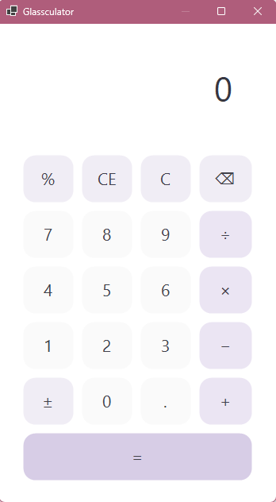

## Calculator
приложение калькулятор, разработанное на языке программирования C# с использованием Windows Forms.

## О проекте
Проект создан в рамках самостоятельного изучения C# и разработки Windows Forms-приложений.

## Скриншот программы

## Возможности
- Сложение, вычитание, умножение и деление.
- Вычисление процент.
- Изменение знака числа.
- Работа с десятичными числами.
- Удаление последнего введеного символа.
- Очистка текущего числа и полный сброс вычислений.
- Обработка деления на ноль.
- Пользовательские скругленные кнопки.

## Используемые технологии
- C#
- .NET
- Windows Forms
- Visual Studio

## Структура проекта
- Program.cs - запуск приложения
- Form1.cs - интерфейс и логика калькулятора
- RoundedButton.cs - класс пользовательских скругленных кнопок
- README.md - описание проекта

## Запуск проекта
1. Скачайте или клонируйте репозиторий
2. Откройте файл решения 
3. Соберите проект
4. Запустите приложение